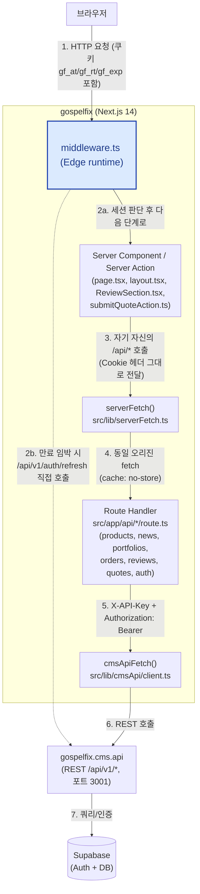

# cms.api 통신 로직을 `src/app/api/`로 일원화

## Context

현재 `src/lib/cmsApi/{products,news,portfolios,orders,reviews,auth}.ts`는 cms.api를 직접
호출하는 함수를 담고 있고, Server Component(`page.tsx`, `layout.tsx`, `ReviewSection.tsx`)가
이 함수들을 **직접 import**해서 호출한다. `src/app/api/`에는 브라우저(클라이언트 컴포넌트)가
호출해야 하는 액션(로그인/회원가입/주문생성/리뷰작성/다운로드)에 한해서만 BFF 프록시 라우트가
존재한다.

사용자 요청: 모든 서버 통신(cms.api 호출)을 `src/app/api/` Route Handler로 옮기고, Server
Component는 lib 함수를 직접 호출하는 대신 자기 자신의 `/api/*`를 fetch해서 데이터를 가져오도록
통일한다. (확인 완료: "모든 Server Component가 lib 함수 대신 자체 /api/* fetch 사용")

이 변경은 SSR 중 자기 자신에게 추가 HTTP 왕복이 하나 더 생기는 트레이드오프가 있지만, 이미
사용자가 이 방향으로 결정했으므로 그대로 진행한다. 동시에 탐색 중 `src/app/actions/
submitQuoteAction.ts`(Server Action)도 `lib/cmsApi/client`의 `cmsApiFetch`를 **직접** 호출하고
있어(app/api를 거치지 않음) 동일한 문제를 갖고 있음을 확인했다 — 이번 리팩토링 범위에 포함한다.
반면 `middleware.ts`는 Edge 런타임에서 매 요청마다 실행되므로 자기 자신의 app/api를 다시
호출하도록 바꾸면 불필요한 지연/순환 위험만 늘어난다 — cms.api를 직접 fetch하는 현재 방식을
그대로 유지한다(범위 제외, 아래 "제외 대상" 참고).

## 아키텍처 다이어그램



**핵심 포인트**

- 브라우저는 cms.api나 Supabase에 직접 닿지 않는다. 항상 `gospelfix` 앱을 경유한다(BFF 패턴).
- `SC → SF → RH` 구간은 SSR 중 **자기 자신에게 보내는 내부 HTTP 요청**이다. 상대 경로 fetch가
  불가능하므로 `serverFetch()`가 `next/headers`의 `headers()`로 절대 URL을 구성하고, 원본 요청의
  `Cookie` 헤더를 수동으로 실어 보낸다(내부 fetch는 별개의 새 요청이라 쿠키가 자동 전달되지 않음).
- `cmsApiFetch()`(`X-API-Key` + `Authorization: Bearer`)는 오직 `route.ts` 안에서만 호출된다 —
  `CMS_API_KEY`가 클라이언트 번들에 노출되지 않도록 하는 절대 규칙.
- `middleware.ts`(Edge 런타임)만 예외적으로 자기 자신의 `/api/*`를 거치지 않고 cms.api를 직접
  호출한다(그림의 점선) — 매 요청마다 실행되는 특성상 내부 왕복/순환 호출 위험을 피하기 위함.

## 핵심 설계: `serverFetch` 헬퍼

Server Component/Server Action에서 **자기 자신의** `/api/*` Route Handler를 호출하기 위한 공용
헬퍼를 새로 만든다. 신규 파일: `src/lib/serverFetch.ts`

- SSR 중에는 상대 경로 fetch가 불가능하므로 `next/headers`의 `headers()`로 현재 요청의
  `host`/`x-forwarded-proto`를 읽어 절대 URL을 구성한다.
- Route Handler가 `getAccessToken()`(쿠키 기반)으로 로그인 여부를 판단하려면, 내부 fetch 요청에
  원본 요청의 `Cookie` 헤더를 그대로 실어 보내야 한다(별도의 새 HTTP 요청이므로 자동으로
  전달되지 않음) — `headers().get("cookie")`를 읽어 그대로 전달.
- 기존 `cmsApiFetch`(`lib/cmsApi/client.ts`)와 동일한 인터페이스로 구현: JSON 파싱, 실패 시
  에러 throw. 이렇게 하면 호출부 코드 형태가 기존과 크게 다르지 않다.
- `cache: "no-store"` 고정 (기존 lib 함수들이 실시간 데이터를 반환하던 것과 동일한 보장).

```ts
// src/lib/serverFetch.ts (핵심 구조)
export class ServerFetchError extends Error { status: number; ... }

async function getBaseUrl(): Promise<string> {
  const h = await headers();
  const host = h.get("host");
  const protocol = h.get("x-forwarded-proto") ?? (prod ? "https" : "http");
  return `${protocol}://${host}`;
}

export async function serverFetch<T>(path: string, init: RequestInit = {}): Promise<T> {
  const cookie = (await headers()).get("cookie") ?? "";
  const res = await fetch(`${await getBaseUrl()}${path}`, {
    ...init,
    cache: "no-store",
    headers: { "Content-Type": "application/json", ...(cookie && { cookie }), ...init.headers },
  });
  const body = ...; // 기존 cmsApiFetch와 동일한 JSON 파싱/에러 처리
  if (!res.ok) throw new ServerFetchError(res.status, body?.error ?? "요청 처리에 실패했습니다.");
  return body as T;
}
```

## 신규/변경 Route Handler (GET 위주로 신설)

각 파일의 로직은 기존 `lib/cmsApi/*.ts`의 내용을 그대로 옮기되(페이지네이션 집계, 404→null
처리 등 기존 동작 100% 보존), 기존 `app/api/*/route.ts` 파일들의 컨벤션(인라인 로직, 별도 lib
파일 분리 없음)을 따른다.

| 신규 라우트 | 대체하는 기존 함수 | 비고 |
|---|---|---|
| `GET src/app/api/products/route.ts` (`?category=`) | `products.ts`의 `getProducts` | 페이지네이션 집계 로직 그대로 이식 |
| `GET src/app/api/products/[slug]/route.ts` | `getProductBySlug` | 실패 시 `{ data: null }` 200 응답(기존처럼 notFound 처리는 페이지 책임) |
| `GET src/app/api/news/route.ts` | `news.ts`의 `getPublishedNews` | 실패 시 `[]` 반환 |
| `GET src/app/api/news/[slug]/route.ts` | `getNewsBySlug` | 실패 시 `{ data: null }` |
| `GET src/app/api/portfolios/route.ts` | `portfolios.ts`의 `getPublishedPortfolios` | 실패 시 throw(기존과 동일) |
| `GET src/app/api/orders/route.ts` (신설, 기존 `orders/create`와 별도) | `orders.ts`의 `getPurchasedOrders` | 실패 시 `[]` 반환. `hasPurchasedProduct`는 별도 엔드포인트 없이 호출부에서 배열 필터링(기존 구현과 동일 패턴) |
| `GET src/app/api/reviews/route.ts` (`?productId=`, 기존 파일에 GET 메서드 추가) | `reviews.ts`의 `getReviewsByProductId` | 기존 POST 핸들러와 공존 |
| `POST src/app/api/quotes/route.ts` (신설) | `submitQuoteAction.ts`가 직접 하던 `cmsApiFetch("/api/v1/quotes")` 호출 | IP/UA/referer는 Server Action이 자신의 `headers()`로 추출해 body에 담아 전달(내부 fetch는 원 요청과 다른 요청이므로) |

`GET /api/auth/me`는 이미 `getCurrentUser`와 동일한 일을 하므로 **변경 없이 재사용**한다.

`getAllNewsSlugs`(`news.ts`)는 프로젝트 전체에서 호출하는 곳이 없는 죽은 코드 — 이식하지 않고
삭제한다.

## 호출부 변경 (대표 패턴)

`page.tsx`/`layout.tsx`/`ReviewSection.tsx`에서 `import { getX } from "@/lib/cmsApi/x"` 직접
호출을 `serverFetch()` 호출로 교체. 대표 예:

- `mall/page.tsx`: `getProducts(category)` → `serverFetch<Product[]>(\`/api/products?category=${category}\`)`
- `detail/[slug]/page.tsx` (page + `generateMetadata` 양쪽): `getProductBySlug(slug)` →
  `const { data: product } = await serverFetch<{ data: Product | null }>(\`/api/products/${slug}\`)`
- `blog/page.tsx`, `blog/[slug]/page.tsx`: news도 동일 패턴
- `(public)/page.tsx`: `getPublishedPortfolios()` → `serverFetch<PortfolioListItem[]>("/api/portfolios")`
- `(dashboard)/layout.tsx`, `(dashboard)/dashboard/page.tsx`, `ReviewSection.tsx`: 더 이상
  `getAccessToken()`을 직접 호출할 필요 없음 — `serverFetch("/api/auth/me")`가 쿠키를 그대로
  전달하므로 Route Handler 내부에서 인증 판단. 에러(미로그인) 시 `null` 처리를 위해 try/catch
  로 감싸는 얇은 헬퍼 `getMe()`를 `src/lib/api/me.ts`에 하나 만들어 3곳에서 재사용(기존
  `getCurrentUser`가 하던 "에러 시 null" 계약을 그대로 보존하기 위함 — 동일 로직 3중 중복 방지)
- `ReviewSection.tsx`의 `hasPurchasedProduct`: `serverFetch<PurchasedOrder[]>("/api/orders")` 결과를
  `.some(o => o.product?.id === productId)`로 직접 필터링(기존 `hasPurchasedProduct` 구현과 동일)
- `PortfolioSwiper.tsx`: `PortfolioListItem` 타입 import 경로만 `@/types/portfolio.types`로 변경(런타임 로직 변경 없음, 타입 전용 import라 원래도 안전했음)

## 타입 이동

기존 `lib/cmsApi/*.ts`에 있던 인터페이스를 프로젝트 컨벤션(`src/types/product.types.ts`가 이미
존재)에 맞춰 `src/types/`로 옮긴다: `news.types.ts`(`NewsItem`, `NewsListItem`),
`portfolio.types.ts`(`PortfolioListItem`), `order.types.ts`(`PurchasedOrder`),
`review.types.ts`(`Review`), `auth.types.ts`(`AuthMeResponse`).

## `lib/cmsApi/` 정리

- **삭제**: `products.ts`, `news.ts`, `portfolios.ts`, `orders.ts`, `reviews.ts`, `auth.ts`
  (도메인 fetch 함수 전부 — Route Handler로 이식 완료)
- **유지**: `client.ts`(`cmsApiFetch` — 이제 `app/api/*/route.ts` 내부에서만 사용),
  `cookies.ts`, `session.ts`(`getAccessToken` 등 — Route Handler + `middleware.ts` +
  `submitQuoteAction.ts`에서 계속 사용)

## 제외 대상 (변경하지 않음)

- `middleware.ts`: Edge 런타임에서 모든 요청마다 실행되며 이미 `cms.api`를 직접 fetch. 자기
  자신의 `/api/*`를 다시 호출하도록 바꾸면 매 요청마다 불필요한 내부 왕복과 순환 호출 위험이
  생기므로 그대로 둔다.
- 이미 `app/api/`에 있는 브라우저용 프록시 라우트(`auth/login`, `auth/signup`, `auth/logout`,
  `orders/create`, `orders/notify-payment`, `downloads/[productId]`)는 구조 변경 없음(이미
  올바른 위치).

## CLAUDE.md 갱신

"cms.api REST API 접근 규칙" 섹션이 현재 "lib/cmsApi/를 Server Component에서 직접 import"를
절대 규칙으로 문서화하고 있으므로, 새 아키텍처(Server Component → `serverFetch()` → 자체
`/api/*` Route Handler → `cmsApiFetch()` → cms.api)로 갱신한다.

## 검증

1. `yarn lint`, `yarn build`(타입 체크 포함)로 정적 검증
2. `yarn dev` 실행 후 브라우저로 아래 플로우 직접 확인:
   - `/mall`(카테고리 필터 포함), `/detail/[slug]`, `/blog`, `/blog/[slug]`, `/`(포트폴리오)
   - 로그인 → `/dashboard`(구매 내역), 상품 상세의 리뷰 섹션(작성/조회), 견적 제출(`/quote`)
   - 비로그인 상태에서 `/dashboard` 접근 시 미들웨어 리다이렉트 정상 동작 확인(미들웨어 미변경 회귀 확인)
