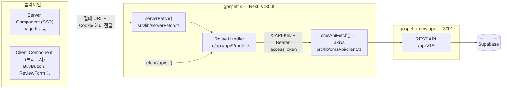

# 가스펄픽스 (GOSPELFIX)

**브랜딩 디자인 소재 마켓플레이스**

CI 로고, 목업, 홈페이지, 대시보드, 이커머스 템플릿, 광고 소재(PSD·AI)까지 — 브랜딩에 필요한 디자인 파일을 구매하고 즉시 다운로드하세요.

🌐 **라이브 서비스**: https://gospelfix.vercel.app

---

## 어떤 서비스인가요?

가스펄픽스(GOSPELFIX)는 브랜드를 만들고 운영하는 데 필요한 모든 디자인 소재를 한 곳에서 판매하는 마켓플레이스입니다.

- CI 로고, 목업, 홈페이지, 대시보드, 이커머스 템플릿, 광고 소재(PSD·AI) 등 다양한 카테고리
- 구매 즉시 파일 다운로드
- 계좌이체 + 관리자 수동 승인 방식의 결제

---

## 주요 기능

| 기능 | 설명 |
|------|------|
| 소재 갤러리 | 카테고리별 필터로 원하는 디자인 소재 탐색 |
| 상세 페이지 | 미리보기 + 포함 항목 확인 |
| 회원가입 / 로그인 | 이메일 인증 기반 |
| 결제 | 계좌이체 + 관리자 수동 승인 |
| 즉시 다운로드 | 결제 승인 후 바로 파일 수령 |

---

## 프로젝트 구조

과거에는 `main/`(사용자 앱)과 `admin/`(관리자 앱)을 한 저장소에 묶은 **모노레포**
구조였다. 지금은 두 앱이 완전히 독립된 저장소로 분리된 **폴리레포(polyrepo)** 구조로,
이 저장소(`gospelfix`)는 사용자 앱(Next.js 14) 단일 프로젝트만 담당한다.

관리자 기능(상품/소식/포트폴리오 CRUD, 주문 승인, 회원 관리 등)은 별도 저장소
`gospelfix.cms.api`로 이전되어 독립 배포되며, 이 앱은 서버 사이드에서만 그 REST
API(`/api/v1/*`)를 호출한다 — 이 통신 방식을 **BFF(Backend For Frontend) 아키텍처**라고
부른다. 자세한 아키텍처는 [CLAUDE.md](./CLAUDE.md)를 참고.

---

## 통신 아키텍처

cms.api REST API 호출은 오직 `src/app/api/*/route.ts` Route Handler 안에서만
일어난다. Server Component와 브라우저(Client Component) 모두 이 Route Handler를
거쳐서만 데이터를 가져오고, Route Handler 안에서만 axios 기반 `cmsApiFetch()`로
cms.api를 호출한다.



- **Server Component → `serverFetch()`**: SSR 중에는 상대 경로 fetch가 불가능해
  `next/headers`의 `headers()`로 현재 요청의 host를 읽어 절대 URL을 만든다. 또한
  내부 fetch는 완전히 새 HTTP 요청이라 로그인 세션 쿠키(`gf_at` 등)가 자동으로
  전달되지 않으므로, 원본 요청의 `Cookie` 헤더를 직접 실어 보낸다.
- **Client Component → Route Handler**: 브라우저는 같은 오리진의 `/api/*`를
  `fetch`/axios로 직접 호출한다. httpOnly 쿠키가 브라우저에 의해 자동 전송되므로
  별도 토큰 처리가 필요 없다.
- **Route Handler → cms.api**: `CMS_API_KEY`(서버간 신뢰)와 필요 시
  `Authorization: Bearer <accessToken>`(사용자 식별)을 실어 cms.api를 호출하는
  코드는 이 레이어에만 존재한다 — `CMS_API_KEY`가 클라이언트 번들에 노출되지
  않도록 하기 위함.

---

## 기술 스택

- Next.js 14 (App Router)
- Tailwind CSS + shadcn/ui
- Recoil (상태 관리)
- Axios

인증/데이터는 Supabase를 직접 호출하지 않고 `gospelfix.cms.api`의 REST API를 통해서만 처리한다.

---

## 로컬 실행

### 사전 준비

- Node.js 24.x, yarn
- `gospelfix.cms.api` 서버가 로컬(기본 3001) 또는 원격에서 실행 중이어야 함

### 환경변수 설정

`.env.development` 또는 `.env.production` 파일 생성:

```env
CMS_API_BASE_URL=http://localhost:3001   # gospelfix.cms.api 서버 주소
CMS_API_KEY=...                          # gospelfix.cms.api의 INTERNAL_API_KEY와 동일한 값
```

나머지 변수(`KAKAO_*`, `NEXT_PUBLIC_*`)는 [`llms.txt`](./llms.txt)의 환경변수 목록을 참고한다.

### 실행

```bash
yarn
yarn dev     # http://localhost:3000
```

---

## 데이터베이스

DB 스키마는 `gospelfix.cms.api` 저장소가 관리한다. 이 저장소는 DB에 직접 접근하지 않는다.

---

## 라이선스

MIT
